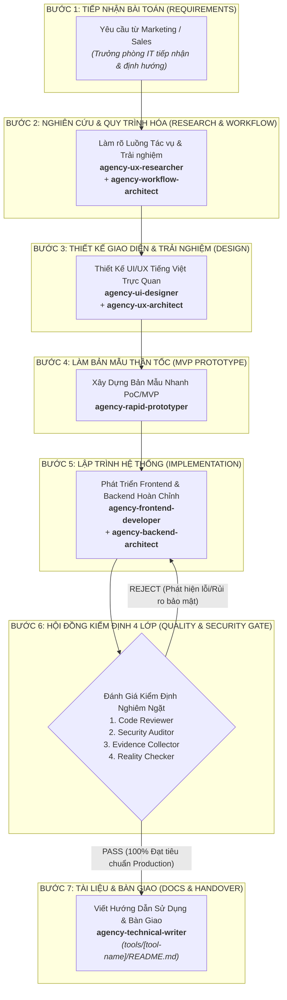

# WORKFLOW: PHÁT TRIỂN CÔNG CỤ NỘI BỘ PHỤC VỤ STUDIO (`build-tool`)

## 1. Tổng quan Chu Trình Kỹ Thuật (Engineering Lifecycle)

---

## 2. Chi Tiết Từng Bước Thực Hiện & Handoff Contracts

### Bước 1: Tiếp Nhận Yêu Cầu Từ Marketing / Sales
- **Đầu vào (Input):** Yêu cầu giải quyết điểm nghẽn thực tế do Trưởng phòng Marketing (`agency-studio-producer`) hoặc Trưởng phòng Sales (`agency-deal-strategist`) đề xuất.
- **Phụ trách:** `agency-software-architect` (Trưởng phòng IT) đánh giá tính cấp thiết, tính khả thi công nghệ và lập lộ trình triển khai.
- **Tiêu chí chấp thuận:** Phải phục vụ trực tiếp cho việc tăng tốc dựng phim hoạt hình AI hoặc tăng tỷ lệ chốt deal bán hàng.

---

### Bước 2: Khảo Sát Trải Nghiệm & Quy Trình Hóa (Research & Workflow)
- **Agent chủ trì:** `agency-ux-researcher` phối hợp `agency-workflow-architect`.
- **Nhiệm vụ:**
  - Khảo sát thói quen thao tác thực tế của nhân sự sáng tạo/kinh doanh để xác định chính xác các điểm ức chế (pain points).
  - Vẽ sơ đồ luồng dữ liệu (Data flow diagram), các kịch bản rẽ nhánh (branching logic) và cơ chế tự phục hồi khi kết nối API ngoài bị gián đoạn.
- **Handoff Output:** Bản đặc tả yêu cầu trải nghiệm (UX Specification) và sơ đồ luồng công việc (Workflow Tree).

---

### Bước 3: Thiết Kế Giao Diện UI & Kiến Trúc Trải Nghiệm UX
- **Agent chủ trì:** `agency-ui-designer` phối hợp `agency-ux-architect`.
- **Nhiệm vụ:**
  - Thiết kế wireframe và mockup trực quan, đáp ứng tiêu chuẩn:
    - *Giao diện 100% tiếng Việt thân thiện, trong sáng, dễ hiểu cho người làm nghệ thuật.*
    - *Thiết kế Responsive, hoạt động mượt mà trên cả trình duyệt máy tính lẫn tablet.*
    - *Bố cục rõ ràng, tối giản thao tác click chuột.*
- **Handoff Output:** Bản thiết kế giao diện chi tiết (UI Layouts, Design System tokens, Component Specs).

---

### Bước 4: Xây Dựng Bản Mẫu Thần Tốc (Rapid Prototyping)
- **Agent chủ trì:** `agency-rapid-prototyper`.
- **Nhiệm vụ:**
  - Dựng phiên bản MVP/Proof of Concept trong vòng 24-48 giờ bằng các công nghệ nhanh gọn (Single Page HTML5/Tailwind/Vanilla JS hoặc Streamlit/FastAPI).
  - Cho đại diện Marketing hoặc Sales dùng thử và lấy phản hồi thực tế ngay tại chỗ.
- **Handoff Output:** Bản chạy thử nghiệm (Working Prototype) có tính tương tác cao.

---

### Bước 5: Lập Trình Hệ Thống (Frontend & Backend Build)
- **Agent chủ trì:** `agency-frontend-developer` và `agency-backend-architect`.
- **Nhiệm vụ:**
  - `agency-frontend-developer`: Viết mã nguồn UI sạch, module hóa, hiệu năng cao, không giật lag khi tải video/ảnh lớn.
  - `agency-backend-architect`: Thiết kế API RESTful, database lưu trữ nhẹ gọn (SQLite/JSON persistence), xử lý tác vụ background (batch render, webhook thông báo).
  - Hỗ trợ chuyên sâu:
    - `agency-ai-engineer`: Kết nối và quản trị model AI tạo ảnh/video.
    - `agency-video-streaming-engineer`: Tối ưu hóa player phát video mượt mà và preview timeline frame-by-frame.
    - `agency-mcp-builder`: Xây dựng máy chủ MCP nếu công cụ cần kết nối trực tiếp với trợ lý Antigravity.
- **Handoff Output:** Mã nguồn hoàn chỉnh đặt trong thư mục `tools/[ten-cong-cu]/`.

---

### Bước 6: Hội Đồng Kiểm Định Độc Lập 4 Lớp (Quality & Security Gate)
Mã nguồn công cụ nội bộ bắt buộc phải được thẩm định nghiêm ngặt qua 4 cửa sổ kiểm soát độc lập trước khi nghiệm thu:
1. **`agency-code-reviewer`:** Soát toàn bộ source code, bảo đảm clean code, dễ bảo trì, đúng chuẩn thiết kế và không dư thừa mã rác.
2. **`agency-ai-generated-code-security-auditor`:** Quét bảo mật toàn diện: tuyệt đối không hardcode API key, chặn đứng nguy cơ SQL injection, Cross-Site Scripting (XSS), Local File Inclusion (LFI) và rò rỉ secret ra ngoài client.
3. **`agency-evidence-collector`:** Chạy kịch bản test thực tế trên môi trường máy, chụp ảnh màn hình hoặc trích xuất log kiểm thử cụ thể chứng minh tool hoạt động đúng spec.
4. **`agency-reality-checker`:** Người gác cổng cuối cùng (The Skeptic), thẩm tra bằng chứng từ 3 bước trên và chỉ cấp chứng nhận **PRODUCTION-READY** khi mọi bằng chứng kiểm thử hoàn toàn minh bạch.

---

### Bước 7: Viết Hướng Dẫn Sử Dụng & Bàn Giao Studio
- **Agent chủ trì:** `agency-technical-writer`.
- **Nhiệm vụ:**
  - Soạn tài liệu hướng dẫn sử dụng chi tiết đặt tại `tools/[ten-cong-cu]/README.md`.
  - Hướng dẫn cài đặt nhanh (Getting Started trong 3 bước), mô tả các nút bấm, phím tắt và xử lý sự cố thường gặp (Troubleshooting).
  - Bàn giao công cụ chính thức cho đội ngũ Marketing & Sales sử dụng hàng ngày.
