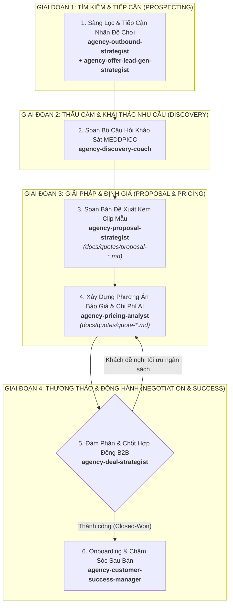

# WORKFLOW: QUY TRÌNH CHỐT DEAL B2B VỚI NHÃN HÀNG ĐỒ CHƠI (`close-deal`)

## 1. Tổng quan Phễu Bán Hàng (Sales Pipeline Overview)

---

## 2. Chi Tiết Từng Bước Thực Hiện & Handoff Contracts

### Bước 1: Sàng Lọc & Tiếp Cận Khách Hàng (Outbound Prospecting)
- **Agent chủ trì:** `agency-outbound-strategist` (phối hợp `agency-offer-lead-gen-strategist`).
- **Nhiệm vụ:**
  - Lập danh sách doanh nghiệp mục tiêu: Các nhà sản xuất đồ chơi trong nước và quốc tế, nhà phân phối độc quyền thương hiệu đồ chơi trẻ em, chuỗi siêu thị mẹ & bé.
  - Thiết kế thông điệp tiếp cận (Cold email / LinkedIn outreach) với giá trị vượt trội:
    - *"Sản xuất clip hoạt hình quảng cáo 3D cho bộ sưu tập đồ chơi mới với chi phí chỉ bằng 1/3 và tiến độ trong 48 giờ nhờ sức mạnh Generative AI."*
  - Đính kèm ưu đãi mồi câu (Lead Magnet): Tặng miễn phí 1 kịch bản hoạt hình ngắn 5s concept cho sản phẩm đồ chơi chủ lực của họ.
- **Handoff Output:** Danh sách Qualified Leads có nhu cầu thật.
- **Mẫu Prompt kích hoạt:**
  > "Hãy đóng vai `agency-outbound-strategist`. Hãy soạn chuỗi 3 email tiếp cận cá nhân hóa gửi Giám đốc Marketing của một công ty đồ chơi lắp ráp thông minh, thuyết phục họ chuyển từ hình thức quay TVC truyền thống sang sản xuất phim hoạt hình AI."

---

### Bước 2: Chuẩn Bị Bộ Câu Hỏi Discovery & Khảo Sát Nhu Cầu
- **Agent chủ trì:** `agency-discovery-coach`.
- **Nhiệm vụ:**
  - Xây dựng bảng kịch bản phỏng vấn thấu cảm theo chuẩn MEDDPICC trước cuộc họp với khách hàng:
    - **Metrics:** Nhãn hàng kỳ vọng chỉ số đo lường nào? (Doanh số bán ra, lượt xem TikTok, hay nhận diện thương hiệu dịp lễ hội?).
    - **Economic Buyer:** Ai là người ký duyệt ngân sách và phê duyệt nghiệm thu?
    - **Decision Criteria:** Tiêu chí chọn studio là gì? (Tốc độ sản xuất, tính thẩm mỹ của nhân vật 3D, hay giá thành?).
    - **Identify Pain:** Nỗi đau hiện tại của họ là gì? (Làm 3D animation truyền thống mất 2-3 tháng và chi phí quá đắt đỏ, không bắt kịp mùa vụ bán hàng).
- **Handoff Output:** Tài liệu hướng dẫn cuộc họp Discovery Meeting Sheet.

---

### Bước 3: Soạn Bản Đề Xuất Giải Pháp (Proposal) Kèm Clip Mẫu
- **Agent chủ trì:** `agency-proposal-strategist`.
- **Nhiệm vụ:**
  - Tổng hợp thông tin từ buổi Discovery để soạn thảo Proposal hấp dẫn, lưu tại `docs/quotes/proposal-[ten-khach-hang].md`.
  - Phối hợp với phòng Marketing & Clip AI để chọn 1-2 video mẫu (Demo Showreel) có phong cách phù hợp nhất với đồ chơi của khách để đính kèm.
- **Handoff Output:** File Proposal đầy đủ luận điểm giá trị, phương án cốt truyện, phong cách nghệ thuật và timeline giao hàng.

---

### Bước 4: Xây Dựng Phương Án Báo Giá & Phân Tích Chi Phí AI
- **Agent chủ trì:** `agency-pricing-analyst`.
- **Nhiệm vụ:**
  - Bóc tách chi phí điện toán AI: Số lượng credit render ảnh/video, chi phí voiceover AI bản quyền thương mại, chi phí model upscale.
  - Xây dựng 3 gói tùy chọn (Tiered Pricing) tạo thế đòn bẩy tâm lý:
    1. *Gói Khám Phá (Starter):* 1 Clip hoạt hình 30s + 3 phiên bản cắt ngắn 15s cho TikTok.
    2. *Gói Bùng Nổ Mùa Vụ (Growth):* 3 Clip cốt truyện khác nhau + bộ ảnh carousel giới thiệu chi tiết đồ chơi.
    3. *Gói Thống Lĩnh Thị Trường (Enterprise):* Series 10 tập hoạt hình ngắn xây dựng vũ trụ nhân vật cho thương hiệu đồ chơi.
- **Handoff Output:** Bảng báo giá chính thức lưu tại `docs/quotes/quote-[ten-khach-hang].md`.

---

### Bước 5: Đàm Phán & Chốt Hợp Đồng B2B (Closing)
- **Agent chủ trì:** `agency-deal-strategist` (Trưởng phòng Sales).
- **Nhiệm vụ:**
  - Xử lý các phản đối cuối cùng (Objection handling) về bản quyền nhân vật, chính sách chỉnh sửa miễn phí (thường là 2 vòng chỉnh sửa) và tiến độ thanh toán (50% cọc - 50% khi nghiệm thu).
  - Phối hợp với `agency-pipeline-analyst` để ghi nhận thương vụ thành công (Closed-Won) và cập nhật doanh thu vào hệ thống.
- **Handoff Output:** Hợp đồng dịch vụ sản xuất phim quảng cáo được hai bên hoàn tất ký kết.

---

### Bước 6: Onboarding Dự Án & Chăm Sóc Sau Bán Hàng (Customer Success)
- **Agent chủ trì:** `agency-customer-success-manager`.
- **Nhiệm vụ:**
  - Tổ chức buổi họp bàn giao bàn giao dự án sang phòng Marketing (`agency-studio-producer`), mở kênh liên lạc riêng với khách hàng.
  - Gửi báo cáo tiến độ định kỳ hàng ngày, thu nhận ý kiến phản hồi và đo lường chỉ số hài lòng (CSAT).
  - Khởi động chiến lược chăm sóc lâu dài để tái ký hợp đồng cho các đợt phát hành đồ chơi tiếp theo của nhãn hàng.
