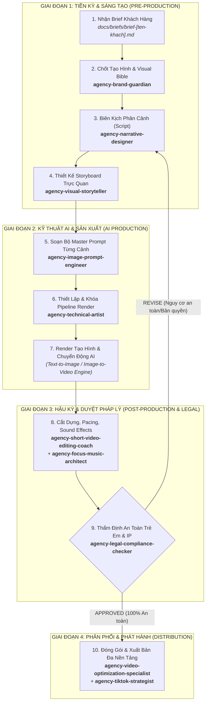

# WORKFLOW: SẢN XUẤT PHIM HOẠT HÌNH AI QUẢNG CÁO ĐỒ CHƠI (`make-clip`)

## 1. Tổng quan Luồng Sản Xuất (Pipeline Overview)

---

## 2. Chi Tiết Từng Bước Thực Hiện & Handoff Contracts

### Bước 1: Tiếp Nhận & Phân Tích Brief Khách Hàng
- **Đầu vào (Input):** File brief lưu tại `docs/briefs/brief-[ten-khach-hang].md` gồm: loại đồ chơi (búp bê, xe đua biến hình, mô hình lắp ráp LEGO-compatible, boardgame thiếu nhi), độ tuổi mục tiêu (ví dụ 3-6 tuổi), tính năng kỳ diệu cần làm nổi bật, thời lượng mục tiêu (15s, 30s, 60s).
- **Phụ trách:** `agency-studio-producer` kiểm tra tính hợp lệ và xác nhận đủ dữ liệu trước khi kickoff.
- **Tiêu chuẩn hoàn thành (DoD):** Brief có mục tiêu rõ ràng, tệp khách hàng xác định, ngân sách token/credit khả thi.

---

### Bước 2: Chốt Tạo Hình Nhân Vật & Phong Cách Thị Giác (Visual Bible)
- **Agent chủ trì:** `agency-brand-guardian` (phối hợp `agency-whimsy-injector`).
- **Nhiệm vụ:**
  - Định hình phong cách thị giác (3D CGI Pixar/Disney Style, Claymation đất nặn stop-motion, hay Anime tươi sáng).
  - Khóa Character Sheet (màu sắc Pantone, tỷ lệ mắt to thân thiện, nụ cười vui vẻ, đường nét bo tròn an toàn, không có góc cạnh sắc nhọn gây nguy hiểm tiềm ẩn).
- **Handoff Output:** Tài liệu `Visual Style Guide` & File tham chiếu nhân vật (Character Seed / LoRA tags).
- **Mẫu Prompt kích hoạt:**
  > "Hãy đóng vai `agency-brand-guardian`. Dựa trên brief tại `docs/briefs/brief-toycar.md`, hãy xây dựng Character Sheet và Visual Bible cho mẫu xe ô tô đồ chơi biết biến hình, đảm bảo tính dễ thương, thân thiện với trẻ em 4-7 tuổi và nhất quán màu sắc."

---

### Bước 3: Biên Kịch Kịch Bản Phân Cảnh (Scriptwriting)
- **Agent chủ trì:** `agency-narrative-designer`.
- **Nhiệm vụ:**
  - Viết kịch bản theo cấu trúc "3-Giây Vàng Giữ Chân":
    - *0-3s (The Hook):* Mở màn bất ngờ, đồ chơi phát sáng hoặc bắt đầu chuyển động kỳ diệu.
    - *4-20s (The Adventure/Play):* Nhân vật đồ chơi tương tác trong thế giới tưởng tượng của bé, phô diễn các tính năng độc đáo.
    - *21-30s (Call To Action / Joy):* Bé và gia đình cười vui, logo nhãn hàng đồ chơi xuất hiện kèm âm thanh thương hiệu (Audio watermark).
- **Handoff Output:** File kịch bản hoàn chỉnh tại `docs/scripts/script-[ten-du-an].md`.
- **Mẫu Prompt kích hoạt:**
  > "Hãy đóng vai `agency-narrative-designer`. Dựa trên Visual Bible vừa lập, hãy viết kịch bản phân cảnh 30 giây (gồm 6 shot) cho clip quảng cáo món đồ chơi này, có lời thuyết minh tiếng Việt ấm áp và hành động hoạt họa sống động."

---

### Bước 4: Thiết Kế Storyboard Trực Quan (Storyboard Design)
- **Agent chủ trì:** `agency-visual-storyteller`.
- **Nhiệm vụ:**
  - Quy định góc máy (Camera Angle: Low angle tôn vinh đồ chơi, Close-up chi tiết bàn tay trẻ bấm nút, Tracking shot xe chạy vèo qua chướng ngại vật).
  - Phân bổ thời lượng chi tiết cho từng scene (giây).
- **Handoff Output:** Bảng mô tả Storyboard chi tiết từng cảnh (Action, Camera framing, Mood, Lighting).

---

### Bước 5: Soạn Bộ Master Prompt Từng Cảnh (Shot-by-Shot Prompting)
- **Agent chủ trì:** `agency-image-prompt-engineer`.
- **Nhiệm vụ:**
  - Chuyển ngữ Storyboard thành bộ Prompt chi tiết cho các công cụ AI (Midjourney v6, Kling 1.5, Runway Gen-3, Luma Dream Machine).
  - Thiết lập cú pháp chuẩn: `[Subject] + [Action] + [Toy Design Details] + [Lighting & Style: Pixar 3D animated, octane render, soft warm lighting] + [Camera Params: --ar 9:16 --c 5 --style raw]`.
  - Thiết lập Negative Prompts nghiêm ngặt: loại trừ dị tật ngón tay, mắt méo mó, hình ảnh u tối hoặc vũ khí nguy hiểm.
- **Handoff Output:** Bảng Master Prompts sẵn sàng nạp vào pipeline dựng.

---

### Bước 6: Thiết Lập & Khóa Pipeline Render (Pipeline Setup)
- **Agent chủ trì:** `agency-technical-artist`.
- **Nhiệm vụ:**
  - Kiểm tra và đồng bộ hóa Seed nhân vật qua các frame, quy định phương pháp Motion Transfer hoặc ControlNet OpenPose để bảo toàn dáng vẻ đồ chơi.
  - Chuẩn hóa tỷ lệ khung hình: 9:16 (1080x1920) cho nền tảng video ngắn (TikTok, Reels, Shorts) hoặc 16:9 (1920x1080) cho TVC.
- **Handoff Output:** Render config spec đã khóa tham số.

---

### Bước 7: Render Tạo Hình & Chuyển Động AI (Generation)
- Thực hiện chạy batch render hình ảnh tĩnh và chuyển động video thông qua các mô hình AI đã cấu hình.

---

### Bước 8: Hậu Kỳ, Cắt Dựng & Thiết Kế Âm Thanh (Editing & Audio)
- **Agent chủ trì:** `agency-short-video-editing-coach` phối hợp `agency-focus-music-architect`.
- **Nhiệm vụ:**
  - Cắt ghép với nhịp độ vui tươi, dứt khoát; chèn hiệu ứng chuyển cảnh mềm mại (Whip pan, Zoom transitions).
  - Lồng ghép voiceover tiếng Việt tự nhiên, truyền cảm.
  - Phối nhạc nền vui tươi (Upbeat playful kids music, 120-128 BPM) và hiệu ứng âm thanh (SFX: "ting", "vút", tiếng cười trẻ thơ).
- **Handoff Output:** Bản dựng video hoàn chỉnh (Draft Cut v1.0).

---

### Bước 9: Cổng Thẩm Định An Toàn Trẻ Em & Bản Quyền (Legal Gatekeeper)
- **Agent chủ trì:** `agency-legal-compliance-checker` (**BẮT BUỘC**).
- **Nhiệm vụ kiểm định:**
  1. *An toàn vật lý & hành vi:* Không mô tả hành vi nguy hiểm mà trẻ em có thể bắt chước (nuốt đồ chơi nhỏ, trèo cao, nghịch điện). Phải có dòng lưu ý "Cần có người lớn giám sát cho trẻ dưới 3 tuổi" nếu áp dụng.
  2. *Quy định quảng cáo trẻ em:* Tuân thủ nghiêm ngặt chuẩn mực CARU và Đạo luật COPPA (Không phóng đại tính năng vượt quá thực tế; đồ chơi cần pin phải ghi rõ "Chưa bao gồm pin").
  3. *Sở hữu trí tuệ (IP):* Kiểm tra không xâm phạm nhãn hiệu hoặc nhân vật hoạt hình bản quyền của hãng khác (Disney, Marvel, v.v.).
- **Quy tắc duyệt:**
  - **APPROVED:** Cấp chứng chỉ phê duyệt và chuyển sang Bước 10.
  - **REVISE:** Ghi rõ cảnh vi phạm và trả về Bước 3/Bước 8 để chỉnh sửa ngay lập tức.

---

### Bước 10: Đóng Gói & Xuất Bản Đa Nền Tảng (Publishing & Distribution)
- **Agent chủ trì:** `agency-video-optimization-specialist` kết hợp `agency-tiktok-strategist`.
- **Nhiệm vụ:**
  - Đóng gói file video master chất lượng cao nhất.
  - Thiết kế thumbnail có độ tương phản cao, biểu cảm nhân vật sinh động thu hút ánh nhìn trong 0.5 giây đầu lướt feed.
  - Viết tiêu đề, caption gợi mở sự tò mò cho cả phụ huynh lẫn các bé; danh sách hashtag xu hướng (#dochoitreem #toyunboxing #hoathinhAI #familyfun).
- **Handoff Output:** Gói xuất bản hoàn chỉnh (Video files + Thumbnails + Copywriting text sẵn sàng đăng tải).
