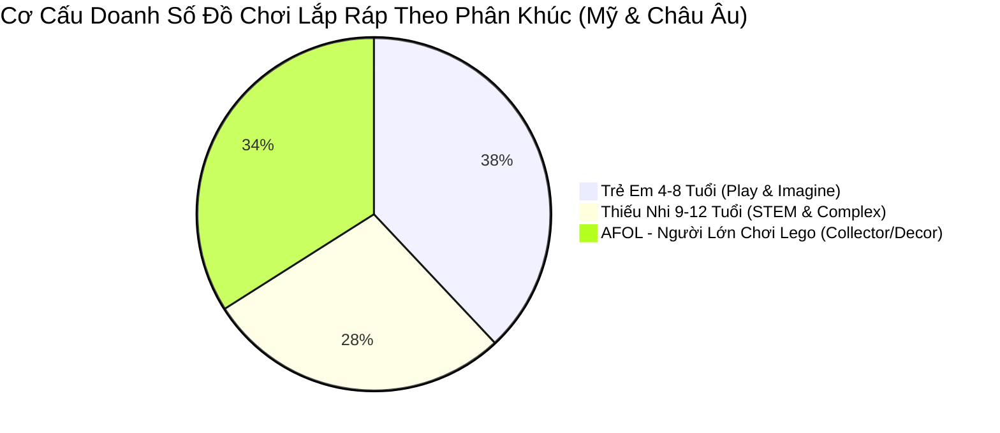
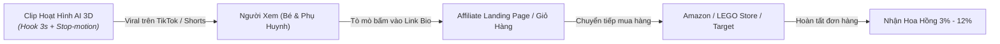

# BÁO CÁO CHIẾN LƯỢC: PHÂN TÍCH THỊ TRƯỜNG ĐỒ CHƠI LẮP RÁP (LEGO) TẠI MỸ & CHÂU ÂU VÀ MÔ HÌNH AFFILIATE MARKETING CHO PHIM HOẠT HÌNH AI

**Đơn vị thực hiện:** Phòng Marketing & Clip AI (`agency-social-media-strategist`, `agency-tiktok-strategist`, `agency-video-optimization-specialist`) phối hợp Ban Pháp lý (`agency-legal-compliance-checker`)  
**Ngày lập:** 08/11/2026  
**Mục tiêu:** Định hướng sản xuất chuỗi video hoạt hình AI quảng cáo đồ chơi kết hợp kiếm tiền qua mạng lưới tiếp thị liên kết (Affiliate Marketing).

---

## PHẦN 1: BẢNG PHÂN TÍCH THỊ TRƯỜNG LEGO & ĐỒ CHƠI LẮP RÁP TẠI MỸ VÀ CHÂU ÂU

### 1.1. Tổng Quan Quy Mô Thị Trường (Market Sizing & Growth)
- **Quy mô toàn cầu:** Ngành đồ chơi lắp ráp (Construction/Building Blocks) đạt quy mô hơn **\$14.8 tỷ USD**, trong đó LEGO Group chiếm trên **65% thị phần**, đạt tốc độ tăng trưởng kép (CAGR) **6.8%**.
- **Thị trường Mỹ (Bắc Mỹ):** Thị trường tiêu thụ lớn nhất thế giới (~38% doanh số toàn cầu). Đặc trưng bởi sức mua khổng lồ vào dịp Black Friday, Cyber Monday và mùa Giáng Sinh (Q4 đóng góp 55% doanh số năm).
- **Thị trường Châu Âu:** Quê hương của LEGO (Đan Mạch, Đức, Anh, Pháp). Người tiêu dùng có tiêu chuẩn khắt khe về tính bền vững, vật liệu nhựa tái chế/sinh học và giá trị giáo dục.

---

### 1.2. Bảng Ma Trận So Sánh Thị Trường: MỸ vs. CHÂU ÂU

| Tiêu Chí Đánh Giá | Thị Trường Mỹ (United States) | Thị Trường Châu Âu (EU & UK) | Hàm Ý Cho Video Hoạt Hình AI |
| :--- | :--- | :--- | :--- |
| **Quy mô & Tiềm năng** | Cực lớn, người tiêu dùng sẵn sàng chi tiêu nhanh, trung bình $320/trẻ/năm cho đồ chơi. | Ổn định, chi tiêu trung bình €240/trẻ/năm. Thị trường Đức và Bắc Âu chuộng dòng LEGO Technic và Creator. | Clip nhắm thị trường Mỹ cần kích thích cảm xúc mua sắm tức thì (FOMO), clip Châu Âu tập trung vào tính tỉ mỉ và bài học tư duy. |
| **Kênh Mua Sắm Chính** | Amazon (46%), Target, Walmart, Chuỗi LEGO Store chính hãng. | Amazon EU, Smyths Toys, Otto (Đức), Bol.com (Hà Lan), Cdiscount (Pháp). | Các link Affiliate cần tích hợp đa nền tảng (Amazon Associates, Target Circle, Awin EU). |
| **Phân Khúc Bùng Nổ** | **AFOL (Adult Fans of LEGO):** Chiếm tới 35% doanh thu; người lớn mua để xả stress, trưng bày nhà cửa (Botanical, Star Wars, Architecture). | Tương tự Mỹ, nhưng có thêm phân khúc mạnh về giáo dục STEAM cho học đường. | Cần sản xuất 2 dòng clip riêng biệt: 1 dòng vui nhộn cho trẻ nhỏ, 1 dòng "Aesthetic cinematic chill" cho người lớn. |
| **Nền Tảng Tiêu Thụ Video** | TikTok, YouTube Shorts, Instagram Reels. Tỷ lệ click link mua hàng qua mạng xã hội rất cao. | YouTube (dài & Shorts), Instagram Reels, TikTok (đang tăng nhanh). | Ưu tiên định dạng dọc 9:16 thời lượng 15s - 30s. |
| **Rào Cản Pháp Lý** | Luật COPPA và hướng dẫn FTC Endorsement Guides rất khắt khe về gắn link affiliate. | GDPR-K, Chỉ thị DSA (Digital Services Act) cấm thuật toán nhắm quảng cáo vào trẻ em dưới 16 tuổi. | **BẮT BUỘC:** Mọi lời kêu gọi mua hàng phải nhắm tới phụ huynh; khai báo hashtag `#ad` hoặc `#affiliatelink` rõ ràng. |

---

## PHẦN 2: BẢNG PHÂN TÍCH AFFILIATE MARKETING CHO PHIM HOẠT HÌNH AI QUẢNG CÁO ĐỒ CHƠI

Mô hình: **Sản xuất video hoạt hình AI siêu tốc (AI Animated Commercials) ➔ Đăng tải trên TikTok/YouTube Shorts/Reels ➔ Gắn link Affiliate (Bio / Giỏ hàng) ➔ Nhận hoa hồng bán hàng tự động.**

---

### 2.1. Bảng So Sánh Các Mạng Lưới Tiếp Thị Liên Kết (Affiliate Programs)

| Tên Mạng Lưới / Chương Trình | Mức Hoa Hồng (Commission) | Thời Gian Lưu Cookie | Ưu Điểm Nổi Bật | Nhược Điểm Cần Lưu Ý |
| :--- | :---: | :---: | :--- | :--- |
| **Amazon Associates (Mỹ & EU)** | **3.0% - 4.5%** *(Ngành Đồ chơi)* | 24 giờ | Tỷ lệ chuyển đổi mua hàng cao nhất thế giới; khách mua thêm đồ khác vẫn nhận hoa hồng trọn giỏ. | Thời gian lưu cookie ngắn (24h); chính sách kiểm duyệt tài khoản nghiêm ngặt. |
| **LEGO Official Affiliate (qua Rakuten / Impact)** | **3.0% - 5.0%** | 30 ngày | Bán trực tiếp từ website LEGO.com; khách mua các set độc quyền giá trị cao ($200 - $800). | Tỷ lệ chuyển đổi thấp hơn Amazon do người dùng phải tạo tài khoản mới. |
| **Target Circle Partners (Mỹ)** | **4.0% - 5.0%** | 7 ngày | Thương hiệu cực kỳ uy tín với các bà mẹ Mỹ (Soccer Moms); thường xuyên có khuyến mãi mua 1 tặng 1. | Chỉ áp dụng thị trường nội địa Mỹ. |
| **Walmart Creator Network** | **4.0%** | 3 ngày | Giá rẻ, tập trung phân khúc bình dân, ship hỏa tốc tại Mỹ. | Giao diện và công cụ tracking chưa tối ưu bằng Amazon. |
| **TikTok Shop Creator Affiliate** | **5.0% - 12.0%** | Tức thì trong phiên | Gắn nút "Giỏ hàng màu vàng" trực tiếp trên video; người xem bấm mua không cần rời ứng dụng. | Hàng hóa chủ yếu là đồ chơi non-LEGO hoặc đồ chơi lắp ráp thông minh từ các thương hiệu OEM. |

---

### 2.2. Chiến Lược Kịch Bản Phim Hoạt Hình AI Tối Ưu Tỷ Lệ Chuyển Đổi (High-Converting Video Formulas)

Để clip hoạt hình AI đạt tỷ lệ click vào link Affiliate cao nhất, phòng Marketing đề xuất **3 cấu trúc kịch bản chuyên biệt**:

#### Công thức 1: "The Magical Unboxing & Assembly" (Dành cho trẻ em & Phụ huynh)
- **Thời lượng:** 25 - 30 giây.
- **Phong cách:** 3D Pixar Animation kết hợp hiệu ứng Claymation stop-motion từng mảnh ghép bay tự lắp ráp.
- **Hook (0-3s):** Chiếc hộp đồ chơi rung lắc, các viên gạch LEGO tự bay ra ngoài xếp thành tòa lâu đài kỳ ảo kèm âm thanh "click-clack" vui tai.
- **Body (4-20s):** Nhân vật tí hon bước đi trong mô hình, kích hoạt tính năng chuyển động bí mật.
- **Call-To-Action (21-30s):** *"Bố mẹ ơi, chạm vào link ở phần tiểu sử để nhận ngay mã giảm giá 20% cho bé dịp lễ này nhé!"*.

#### Công thức 2: "Desk Diorama / Stress Relief" (Dành cho phân khúc người lớn AFOL)
- **Thời lượng:** 15 - 20 giây.
- **Phong cách:** Cinematic Macro 3D, ánh sáng ấm áp, nhạc Lo-fi Chill.
- **Nội dung:** Cận cảnh một góc bàn làm việc hiện đại, chậu cây LEGO Bonsai hoặc xe đua F1 phát sáng đèn neon. Âm thanh lắp ráp ASMR cực kỳ thư giãn.
- **Call-To-Action:** Gắn link trực tiếp set LEGO trưng bày trên Amazon / LEGO Shop.

---

### 2.3. Quy Định Pháp Lý & An Toàn Bắt Buộc (Do Legal Compliance Checker Duyệt)
1. **Tuân thủ FTC (Mỹ):** Bắt buộc phải có thẻ thông báo rõ ràng trong caption và trên màn hình: `#ad`, `#affiliate`, hoặc `#commissionsearned`. Không được giấu hashtag dưới chuỗi hashtag dài.
2. **Tuân thủ COPPA & CARU:**
   - Tuyệt đối không kêu gọi trẻ em trực tiếp: *"Bé hãy bảo bố mẹ mua ngay"* là vi phạm chuẩn mực CARU.
   - Thay vào đó sử dụng câu chữ trung tính: *"Món quà sáng tạo lý tưởng cho cả gia đình – Link chi tiết tại bio dành cho phụ huynh"*.
3. **Tuân thủ bản quyền thương hiệu LEGO:** Không mạo danh là kênh chính thức của Tập đoàn LEGO; phải nêu rõ tư cách người đánh giá/sáng tạo nội dung độc lập.

