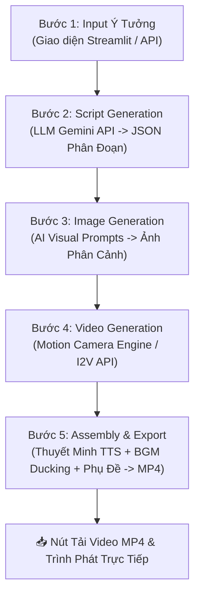

# 🎬 End-to-End AI Video Generation Pipeline

Ứng dụng tự động hóa hoàn chỉnh quy trình sản xuất video hoạt hình / quảng cáo AI từ một câu ý tưởng ban đầu đến video MP4 chất lượng cao (1080p/720p, 30fps), có chuyển động máy quay, giọng đọc thuyết minh tiếng Việt và nhạc nền.

---

## 🌟 Quy Trình Tự Động Hóa 5 Bước (Sequential 5-Step Workflow)



1. **Bước 1 (Input):** Nhận chủ đề hoặc ý tưởng ngắn từ người dùng qua giao diện hiện đại (chọn phong cách, số lượng cảnh, giọng đọc).
2. **Bước 2 (Script Generation):** LLM (Gemini 2.5 Flash / 1.5 Flash) phân tích chủ đề, tuân thủ an toàn trẻ em (CARU/COPPA) và sinh ra kịch bản phân đoạn dạng JSON: số thứ tự cảnh, mô tả hình ảnh tiếng Anh chi tiết (*visual_prompt*), lời thoại tiếng Việt (*voiceover*) và chuyển động máy quay.
3. **Bước 3 (Image Generation):** Tự động gọi API tạo ảnh (Pollinations Flux/Turbo hoặc OpenAI DALL-E 3) với cơ chế kiểm tra ảnh lỗi, backoff retry và bộ tạo canvas dự phòng mỹ thuật.
4. **Bước 4 (Video Generation):** Biến ảnh tĩnh thành cảnh quay video thực thụ bằng **Motion Camera Engine** (Dolly In, Dolly Out, Orbit Pan, Dutch Tilt, Zoom Punch) mượt mà chuẩn 30fps hoặc kết nối API Image-to-Video điện toán đám mây.
5. **Bước 5 (Assembly & Export):** Sử dụng FFmpeg / MoviePy để ghép nối các cảnh theo thứ tự, lồng giọng đọc thuyết minh tiếng Việt tự nhiên (**Edge-TTS / gTTS**), tự động hòa âm nhạc nền (**BGM với Audio Ducking**), đốt cứng phụ đề thẩm mỹ và xuất file video MP4 hoàn chỉnh kèm nút tải về.

---

## 📁 Cấu Trúc Mã Nguồn (Modular Architecture)

```
pipeline/
├── backend/
│   ├── config.py             # Cấu hình biến môi trường, đường dẫn & phong cách hoạt hình
│   ├── models.py             # Pydantic schemas (ScriptResponse, SceneData, TaskStatus)
│   ├── main.py               # FastAPI server (REST endpoints, BackgroundTasks & SSE Stream)
│   └── services/
│       ├── llm_service.py     # Bước 2: Gọi Gemini API sinh kịch bản JSON
│       ├── image_service.py   # Bước 3: Gọi API tạo hình ảnh cho từng cảnh
│       ├── video_service.py   # Bước 4: Động cơ chuyển động máy quay (Image -> Video)
│       ├── tts_service.py     # Bước 5 (Audio): Thuyết minh tiếng Việt (Edge-TTS / gTTS)
│       └── assembly_service.py# Bước 5 (Video): Ghép nối clip, BGM, phụ đề và xuất MP4
├── frontend/
│   └── streamlit_app.py      # Giao diện Dark-Mode trực quan, live progress stepper
├── static/                   # Tài nguyên mẫu (âm thanh BGM, biểu tượng)
├── output/                   # Thư mục lưu trữ video, clip, ảnh xuất bản
├── requirements.txt          # Danh sách thư viện Python cần thiết
├── .env.example              # Mẫu cấu hình API Keys
├── run_backend.py            # Script khởi chạy FastAPI (Port 8000)
└── run_frontend.py           # Script khởi chạy Streamlit (Port 8501)
```

---

## 🛠️ Hướng Dẫn Cài Đặt

### 1. Cài đặt các thư viện cần thiết
Mở terminal (PowerShell hoặc CMD) tại thư mục dự án và chạy lệnh:
```bash
pip install -r pipeline/requirements.txt
```

> **Lưu ý về FFmpeg:** Gói `imageio-ffmpeg` trong file requirements đã tự động tích hợp sẵn file thực thi FFmpeg cho Windows, bạn không cần cài đặt FFmpeg thủ công vào biến môi trường hệ thống.

---

## 🔑 Hướng Dẫn Cấu Hình Biến Môi Trường (API Keys)

Tạo file `.env` tại thư mục `pipeline/` (sao chép từ `pipeline/.env.example`):
```bash
copy pipeline\.env.example pipeline\.env
```

Mở file `pipeline/.env` và điền các khóa API của bạn:
```env
# 1. Gemini API Key (Bắt buộc cho Bước 2: Sinh Kịch Bản Thông Minh)
# Đăng ký key miễn phí tại: https://aistudio.google.com/
GEMINI_API_KEY=AIzaSyYourGeminiApiKeyHere
GEMINI_MODEL=gemini-2.5-flash

# 2. Image Provider (Mặc định dùng pollinations miễn phí, hoặc openai)
IMAGE_PROVIDER=pollinations
OPENAI_API_KEY=sk-your-openai-api-key-here

# 3. Video Engine (Mặc định dùng motion_engine cục bộ không tốn phí)
VIDEO_PROVIDER=motion_engine

# 4. Giọng đọc thuyết minh tiếng Việt
TTS_PROVIDER=edge_tts
TTS_VOICE=vi-VN-HoaiMyNeural   # Hoặc vi-VN-NamMinhNeural
```

> 💡 **Chế độ Chạy Dự Phòng (Smart Fallback Mode):** Ngay cả khi chưa điền `GEMINI_API_KEY`, hệ thống vẫn tự động kích hoạt bộ sinh kịch bản chuyên biệt thông minh theo chủ đề của người dùng, giúp bạn chạy thử nghiệm toàn bộ quy trình 5 bước mà không lo bị ngắt quãng!

---

## 🚀 Hướng Dẫn Khởi Chạy Ứng Dụng

### Cách 1: Khởi chạy 1-Click (Khuyên dùng)
Chạy file script tự động:
- **Windows Batch:** Double-click vào `start_pipeline.bat`
- Hoặc chạy qua PowerShell:
  ```powershell
  .\start_pipeline.ps1
  ```

### Cách 2: Khởi chạy thủ công từng phần

1. **Khởi động Backend (FastAPI - Port 8000):**
   ```bash
   python pipeline/run_backend.py
   ```
   *Kiểm tra Swagger Docs tại: [http://127.0.0.1:8000/docs](http://127.0.0.1:8000/docs)*

2. **Khởi động Frontend (Streamlit - Port 8501):**
   Mở terminal thứ hai và chạy:
   ```bash
   python pipeline/run_frontend.py
   ```
   *Giao diện tự động mở tại: [http://127.0.0.1:8501](http://127.0.0.1:8501)*

---

## 📡 API Endpoints (Dành Cho Nhà Phát Triển)

| Phương thức | Đường dẫn | Chức năng |
|---|---|---|
| `POST` | `/api/generate` | Tiếp nhận yêu cầu, bắt đầu quy trình bất đồng bộ 5 bước |
| `GET` | `/api/status/{task_id}` | Lấy thông tin trạng thái, tiến độ và phân cảnh hiện tại |
| `GET` | `/api/progress/stream/{task_id}` | Stream sự kiện Server-Sent Events (SSE) theo thời gian thực |
| `GET` | `/api/video/{task_id}` | Tải về file video MP4 hoàn chỉnh |
| `GET` | `/api/health` | Kiểm tra tình trạng hoạt động của server |
